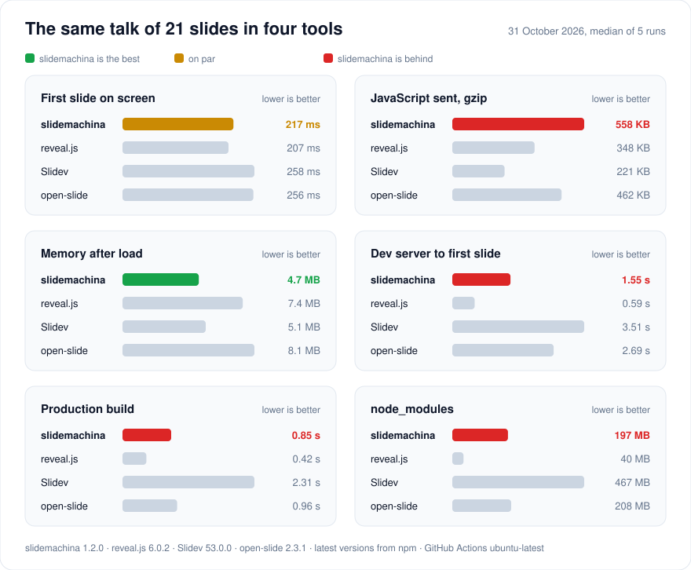

# slidemachina benchmark

31 October 2026. The same talk of 21 slides in the latest versions from npm, median of 5 runs.
The method is in [benchmark/](https://github.com/xfenix/slidemachina/tree/main/benchmark) of the main branch.

| | slidemachina 1.2.0 | reveal.js 6.0.2 | Slidev 53.0.0 | open-slide 2.3.1 |
|---|---|---|---|---|
| First slide on screen | 217 ms | 207 ms | 258 ms | 256 ms |
| JavaScript sent, gzip | 558 KB | 348 KB | 221 KB | 462 KB |
| Memory after load | 4.7 MB | 7.4 MB | 5.1 MB | 8.1 MB |
| Dev server to first slide | 1.55 s | 0.59 s | 3.51 s | 2.69 s |
| Production build | 0.85 s | 0.42 s | 2.31 s | 0.96 s |
| node_modules | 197 MB | 40 MB | 467 MB | 208 MB |
